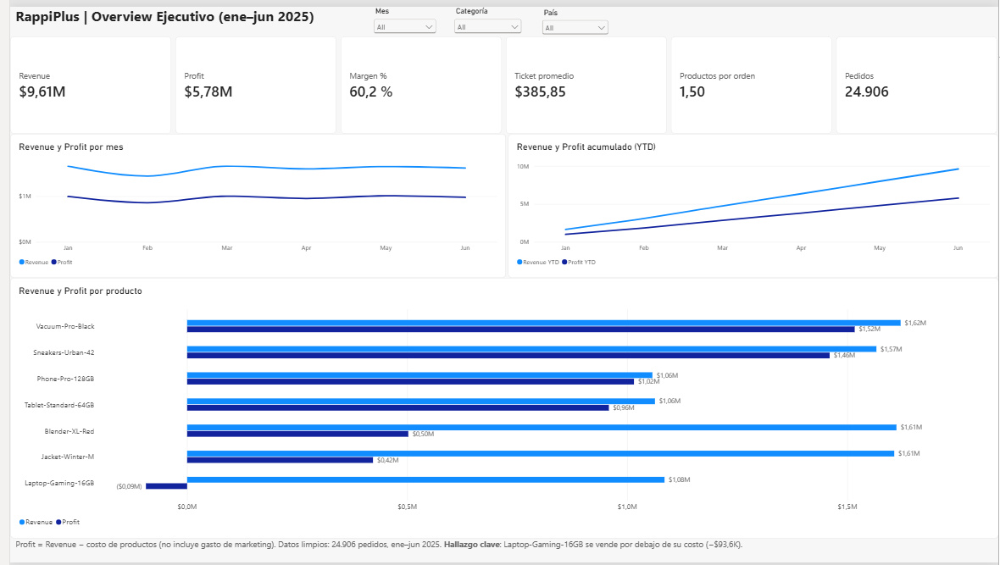
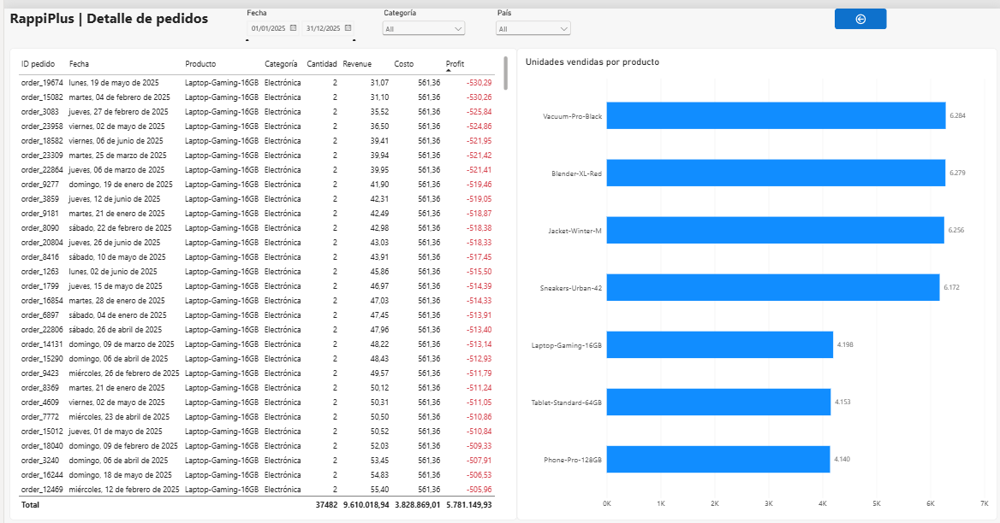
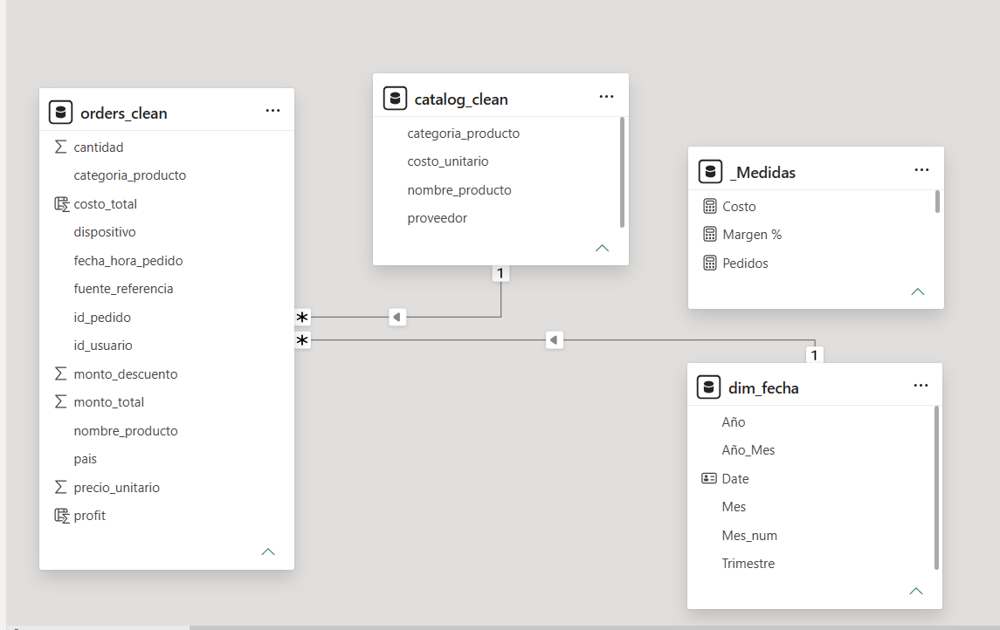

# 📊 Diagnóstico estratégico integral para RappiPlus

**Proyecto final del bootcamp de Data Analyst de TripleTen** · Python · SQL · Estadística · Power BI
[](https://colab.research.google.com/github/stefanloosveld/diagnostico-estrategico-rappiplus/blob/main/notebook/RappiPlus_Proyecto_Final.ipynb)

Análisis de punta a punta de un servicio de delivery por suscripción: desde la **limpieza de datos** hasta un **dashboard ejecutivo**, pasando por rentabilidad, funnel de conversión, retención por cohortes y un test A/B. El objetivo es responder una pregunta de negocio en cada etapa y terminar con **recomendaciones priorizadas**.



---

## 🎯 Preguntas de negocio y respuestas

| # | Pregunta | Respuesta |
|---|---|---|
| 1 | ¿Podemos confiar en los datos? | **Sí, tras la limpieza.** 25,100 → 24,906 pedidos (−0.77%); se recuperaron 432 datos faltantes desde otras columnas y tablas. |
| 2 | ¿El negocio es rentable? | **Sí.** Revenue de USD 9.61 M, profit bruto de USD 5.78 M (60.2%) y profit neto de USD 2.91 M (30.3%). **Laptop-Gaming-16GB pierde dinero** (−USD 93.6 K): se vende por debajo de su costo. |
| 3 | ¿Dónde se pierden los usuarios? | **En el pago:** de `begin_checkout` a `add_payment_info` solo avanza el 86.71% (958 usuarios perdidos). |
| 4 | ¿Los usuarios regresan? | **Parcialmente:** ≈42% sigue activo en las semanas 1–3. Los usuarios *paid* retienen ≈1.7 veces más que los *free*. |
| 5 | ¿Los cambios funcionan? | **No hay evidencia** de que la nueva UI del checkout mejore la conversión (p = 0.416). |
| 6 | ¿Cómo lo comunicamos? | Dashboard de 2 páginas en Power BI con drill-through del KPI general al detalle de cada pedido. |

## 💡 Recomendaciones

1. **Corregir el precio de Laptop-Gaming-16GB** (costo USD 280.68 > precio promedio USD 261.27), renegociar su costo o evaluar retirarla.
2. **Simplificar el paso de pago**, especialmente en *mobile*, y validarlo con un nuevo test A/B con mayor muestra.
3. **Reforzar el onboarding de la primera semana** e impulsar la conversión de *free* a *paid*.
4. **Redistribuir presupuesto de marketing hacia `paid_search`** (ROI de 113% vs ≈95% en otros canales).
5. **Aumentar las unidades por pedido** (hoy 1.5) con combos o descuentos por volumen.

---

## 🛠️ Qué se hizo en cada paso

### 1. Calidad de datos (Python / pandas)
- Eliminación de duplicados, valores inválidos (cantidades y montos ≤ 0) y outliers (pedidos de 10,000 y 20,000 unidades que inflaban el revenue ~5 veces).
- **Recuperación de nulos** en lugar de eliminarlos: categoría desde el catálogo, país desde otros pedidos del mismo usuario y canal desde el ID de campaña.
- Estandarización de textos entre tablas (`Electronica` / `Electrónica`, mayúsculas en países).
- Verificación de consistencia: `monto_total = cantidad × precio − descuento`.

### 2. Rentabilidad (Python)
- Costo por pedido mediante `merge` validado (`many_to_one`) con el catálogo.
- KPIs: revenue, costo, profit bruto y neto, margen, ticket promedio y productos por orden.
- Rentabilidad por producto, categoría, país, canal y dispositivo, con ROI de marketing por país y canal.

### 3. Funnel de conversión (SQL)
- CTE + `CASE` para ordenar las etapas y funciones de ventana `LAG` / `FIRST_VALUE` para la conversión paso a paso y acumulada.

### 4. Retención por cohortes (SQL)
- Cohortes mensuales con `DATE_TRUNC` y retención semanal con conteo condicional `COUNT(DISTINCT CASE WHEN ...)`.
- Análisis adicional de retención por tipo de plan (*free* vs *paid*).

### 5. Test A/B (Python / SciPy)
- Prueba Z bilateral para dos proporciones (α = 0.05), con intervalo de confianza de la diferencia.
- Validaciones: balance de grupos (SRM), contaminación entre grupos y análisis exploratorio por dispositivo.

### 6. Dashboard (Power BI)
- **Modelo estrella:** pedidos (hechos) relacionados 1:* con catálogo y una tabla calendario (`dim_fecha`).
- **12 medidas DAX**, incluidas `TOTALYTD` y `PREVIOUSMONTH`.
- **Página 1 – Overview Ejecutivo:** KPIs, tendencia mensual, acumulado YTD y revenue/profit por producto.
- **Página 2 – Detalle de pedidos:** tabla de órdenes con profit en rojo/verde (formato condicional), unidades por producto y **drill-through** desde la página 1.
- Filtros sincronizados entre páginas (categoría y país).





---

## 📁 Estructura del repositorio

```
diagnostico-estrategico-rappiplus/
├── README.md
├── notebook/
│   └── RappiPlus_Proyecto_Final.ipynb   # Análisis completo (Pasos 1 a 6) con resultados
├── dashboard/
│   └── RappiPlus_Dashboard.pbix         # Dashboard de Power BI (abrir con Power BI Desktop)
└── images/
    ├── 01_overview.png
    ├── 02_detalle.png
    └── 03_modelo.png
```

## ▶️ Cómo revisarlo

- **Notebook:** se puede leer directamente en GitHub con todas sus salidas. Para ejecutarlo se necesita Python 3 con `pandas`, `numpy`, `scipy` y `sqlalchemy`.
- **Pasos 3 y 4 (SQL):** consultan una base de datos PostgreSQL de TripleTen. Por seguridad, **las credenciales no se publican**: la conexión las lee desde variables de entorno (`DB_USER`, `DB_PASSWORD`, `DB_HOST`, `DB_PORT`, `DB_NAME`).
- **Dashboard:** descargar el `.pbix` y abrirlo en Power BI Desktop. Los datos están importados en el archivo, así que se puede explorar sin conexión.

## ⚠️ Limitaciones

- Datos de solo 6 meses (enero–junio 2025): no permiten comparaciones interanuales.
- Algunas métricas son atípicas frente a un e-commerce real (conversión del funnel de 80%), propio de datos simulados con fines educativos.
- El funnel es agregado (no secuencial por usuario) y la relación entre plan pagado y retención es una asociación, no necesariamente causal.

---

## 👤 Autor

**Stefan Loosveld** · Data Analyst
GitHub: [@stefanloosveld](https://github.com/stefanloosveld)

*Proyecto desarrollado como parte del bootcamp de Data Analyst de TripleTen (2026).*
